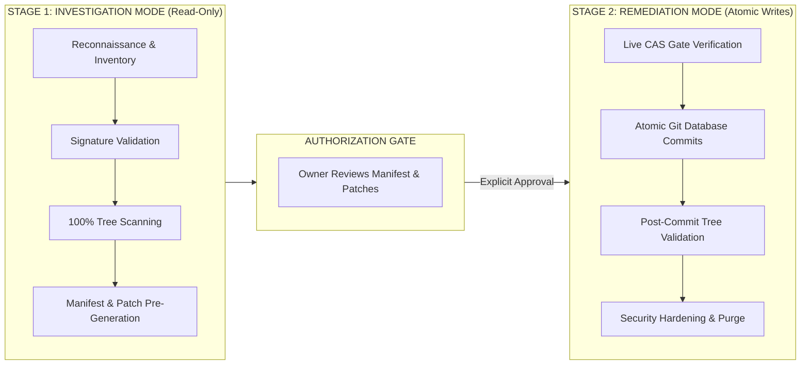
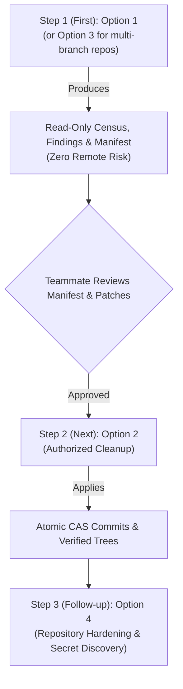

# GitHub Security Incident Response Skill & Forensic Toolkit

A reproducible, evidence-driven operational framework and toolkit for investigating, scanning, remediating, and hardening GitHub repositories affected by coordinated compromises and automated push surges.

---

## 1. Overview & Operating Architecture

This repository contains the operational playbook (`SKILL.md`), forensic documentation, reusable templates, and Python utility scripts developed and battle-tested during the remediation of a 95-repository coordinated GitHub compromise.

To prevent catastrophic data loss, accidental remote damage, or premature modifications, the toolkit operates under a strict **Two-Stage Architecture**:



1. **Investigation Mode (Read-Only)**: Collects repository census, isolates administrative scope, identifies push burst windows, inspects representative samples, formulates high-fidelity signatures, performs 100% repository tree scanning, and pre-generates clean replacement patches locally. **Zero remote modifications permitted.**
2. **Remediation Mode (Authorized Atomic Writes)**: Requires explicit human authorization. Executes single-commit tree mutations directly via GitHub's Git Database REST API, protected by live Compare-and-Swap (CAS) parent verification and followed by automated post-commit tree validation.

---

## 2. Directory Structure

```text
github-security-response-skill/
├── SKILL.md                          # Primary operational playbook and methodology
├── README.md                         # Architecture overview, script catalog & safety guide
├── requirements.txt                  # Pinned dependencies (requests) & prerequisites
├── prompt.txt                        # Ready-to-use Antigravity (agy) prompt cheatsheet
├── toolkit-manifest.json             # Machine-readable inventory with hashes and review status
├── scripts/                          # Preserved original & reviewed investigation scripts
│   ├── analyze_inventory.py          # Timeline and push surge analysis
│   ├── analyze_signatures.py         # Sample deep dive and signature candidate analysis
│   ├── check_amended_files.py        # Author vs committer date audit
│   ├── check_other_pushed.py         # Cross-repository push correlation
│   ├── compare_payloads.py           # Payload byte and hash comparison
│   ├── examine_oct_commits.py        # Spike and cluster timeline analysis
│   ├── execute_bulk_cleanup_v2.py    # PRODUCTION: Atomic Git Database cleanup engine (CAS)
│   ├── execute_bulk_cleanup.py       # HISTORICAL: Prototype cleanup script
│   ├── execute_hardening.py          # PRODUCTION: .gitignore & .vscode/ purge engine
│   ├── extract_iocs.py               # Static deobfuscation and IoC extractor
│   ├── finalize_hardening_reports.py # Hardening summary and checkpoint compiler
│   ├── gate_validation.py            # Pre-modification live branch-tip verification gate
│   ├── generate_knowledge_artifacts.py# Phase 2 documentation and signature compiler
│   ├── generate_phase3_reports.py    # Phase 3 cleanup summary report compiler
│   ├── generate_summary_reports.py   # HISTORICAL: Phase 1 report generator
│   ├── generate_summary_reports_reviewed.py # REVIEWED: Corrected Phase 1 generator
│   ├── hardening_plan.py             # Pre-hardening scanner & tracked .env discovery
│   ├── inventory_recon.py            # Complete Phase 1 account reconnaissance engine
│   ├── scan_and_prepare_remediation.py # Phase 2 100% scanner & patch generator
│   └── test_conn.py                  # API connectivity and token scope verification
├── docs/                             # In-depth forensic and architectural references
│   ├── incident-response-workflow.md # Complete step-by-step incident response workflow
│   ├── malware-indicators.md         # Validated campaign signatures, magic bytes & IoCs
│   ├── false-positives.md            # Preservation boundaries & negative match rules
│   └── recovery-and-containment.md   # Credential rotation, workstation response & scope limits
├── templates/                        # Reusable operational templates
│   ├── incident-checklist.md         # Operational checklist across all phases
│   ├── incident-report-template.md   # Final executive and technical report template
│   └── checkpoint-template.json      # JSON checkpoint schema for batch execution
└── tests/                            # Static validation harness
    └── README.md                     # Syntax checks, AST verification & mocked test guide
```

---

## 3. Script Catalog & Safety Classification

Every script in `scripts/` has been inspected for security, network behavior, and execution side-effects:

| Script Name | Functional Category | Safety Classification | HTTP Methods | Description / Primary Function |
| :--- | :--- | :--- | :---: | :--- |
| **`inventory_recon.py`** | Reconnaissance | `SAFE_READ_ONLY_REMOTE` | `GET` | Paginates `/user/repos`, partitions scope, and records repository metadata. |
| **`analyze_inventory.py`** | Timeline Analysis | `SAFE_READ_ONLY_LOCAL` | `NONE` | Analyzes `pushed_at` timestamps to detect automated push clusters. |
| **`check_amended_files.py`** | History Audit | `SAFE_READ_ONLY_REMOTE` | `GET` | Detects backdated author timestamps vs committer timestamps. |
| **`check_other_pushed.py`** | Anomaly Detection | `SAFE_READ_ONLY_REMOTE` | `GET` | Correlates push timestamps across all personal repositories. |
| **`examine_oct_commits.py`** | Timeline Analysis | `SAFE_READ_ONLY_LOCAL` | `NONE` | Analyzes commit activity spikes across the target month. |
| **`test_conn.py`** | Sanity Check | `SAFE_READ_ONLY_REMOTE` | `GET` | Verifies GitHub CLI token retrieval and `/user` connectivity. |
| **`analyze_signatures.py`** | Malware Analysis | `SAFE_READ_ONLY_REMOTE` | `GET` | Inspects 10 representative repositories to validate compromise indicators. |
| **`compare_payloads.py`** | Binary Comparison | `SAFE_READ_ONLY_REMOTE` | `GET` | Compares payload hashes and structures across multiple repositories. |
| **`extract_iocs.py`** | Static Deobfuscation | `SAFE_READ_ONLY_REMOTE` | `GET` | Decodes hex strings and IoCs without executing suspicious files. |
| **`scan_and_prepare_remediation.py`** | Scanning & Patches | `SAFE_READ_ONLY_REMOTE` | `GET` | Scans 100% of repositories, generates clean patches in `patches/`, and builds manifest. |
| **`gate_validation.py`** | Safety Gate | `SAFE_READ_ONLY_REMOTE` | `GET` | Verifies live default branch tips against baseline commit SHAs (0% drift). |
| **`hardening_plan.py`** | Hardening Planning | `SAFE_READ_ONLY_REMOTE` | `GET` | Scans for tracked `.vscode/` files and discovers tracked `.env` files. |
| **`execute_bulk_cleanup_v2.py`** | Remediation (Production) | `REMOTE_WRITE_AUTHORIZATION_REQUIRED` | `POST, PATCH, GET` | **Production cleanup engine**. Applies atomic commits via Git Database API with CAS. |
| **`execute_bulk_cleanup.py`** | Remediation (Prototype) | `REMOTE_WRITE_AUTHORIZATION_REQUIRED` | `POST, PATCH` | Prototype cleanup script; superseded by v2. |
| **`execute_hardening.py`** | Hardening Execution | `REMOTE_WRITE_AUTHORIZATION_REQUIRED` | `POST, PATCH, GET` | Applies `.gitignore` updates and `.vscode/` purges with CAS protection. |
| **`enforce_signed_commits_ruleset.py`** | Policy Enforcement | `REMOTE_WRITE_AUTHORIZATION_REQUIRED` | `POST, GET` | Deploys active ruleset requiring signed commits across all eligible repositories (~ALL branches). |
| **`generate_summary_reports_reviewed.py`** | Reporting | `SAFE_READ_ONLY_LOCAL` | `NONE` | Compiles Phase 1 reconnaissance report and access limitations. |
| **`generate_summary_reports.py`** | Reporting (Historical) | `SAFE_READ_ONLY_LOCAL` | `NONE` | Original Phase 1 generator (contains unescaped `\U` string in Py3.12+). |
| **`generate_knowledge_artifacts.py`** | Reporting | `SAFE_READ_ONLY_LOCAL` | `NONE` | Compiles Phase 2 analysis, signatures JSON, and false-positives guide. |
| **`generate_phase3_reports.py`** | Reporting | `SAFE_READ_ONLY_LOCAL` | `NONE` | Compiles Phase 3 bulk cleanup ledger and post-commit verification report. |
| **`finalize_hardening_reports.py`** | Reporting | `SAFE_READ_ONLY_LOCAL` | `NONE` | Compiles final hardening report and updates checkpoint telemetry. |

---

## 4. Prerequisites & Environment Setup

1. **Operating System**: Windows 11 (PowerShell), macOS, or Linux.
2. **Python Environment**: Python 3.10+ installed.
3. **GitHub CLI (`gh`)**:
   - Must be installed and authenticated:
     ```bash
     gh auth status
     ```
   - Requires `repo` and `read:org` scopes.
   - Tokens are acquired dynamically by scripts via `gh auth token`; **never** hardcode or export tokens.
4. **Python Dependencies**:
   ```bash
   pip install -r requirements.txt
   ```

---

## 5. Recommended Prompting Sequence for Antigravity (agy)

When your teammates clone this repository and use Antigravity, we strongly recommend following this exact execution sequence from [`prompt.txt`](prompt.txt):



1. **Step 1 (First): Run Option 1** *(or **Option 3** if repositories maintain active `dev`, `staging`, or feature branches)*:
   - **Why first**: It is **100% read-only**. It scans all repositories, detects infected files, validates false positives, pre-generates clean replacement patches in `patches/`, and compiles `remediation-manifest.json` **without touching or modifying anything on GitHub**.
2. **Step 2 (Next): Run Option 2 (Authorized Cleanup)**:
   - **Why next**: After the teammate reviews the findings and approves the manifest, Option 2 executes atomic Git Database API commits protected by Compare-and-Swap (CAS) parent verification and immediately verifies the resulting trees.
3. **Step 3 (Follow-up): Run Option 4 (Security Hardening & Secret Discovery)**:
   - **Why follow-up**: Enforces account-wide `.gitignore` rules (excluding `.env`, `.env.*`, and `.vscode/`) and purges dormant `.vscode/` directories across all repositories.
4. **Step 4 (Final Lock-in): Run Option 5 (Enforce "Require Signed Commits" Ruleset)**:
   - **Why lock-in**: Deploys an automated repository ruleset targeting all branches (`~ALL`) that rejects any unsigned or tampered commits, permanently preventing bot amending or author spoofing attacks.

---

## 6. Standard Operating Procedure (Manual CLI SOP)

### Step 1: Investigation & Full Scan (Investigation Mode)
```bash
# 1. Verify connectivity and token scopes
python scripts/test_conn.py

# 2. Perform complete account inventory and timeline analysis
python scripts/inventory_recon.py
python scripts/analyze_inventory.py

# 3. Analyze representative sample repositories
python scripts/analyze_signatures.py
python scripts/extract_iocs.py

# 4. Scan all repositories and generate local clean replacement patches
python scripts/scan_and_prepare_remediation.py
```

### Step 2: Review Manifest & Safety Gates
1. Review generated `remediation-manifest.json` and inspect `patches/`.
2. Confirm manifest arithmetic: $\text{Total Actions} = \text{Deletions} + \text{Modifications}$.
3. Verify that all in-scope repositories match baseline branch-tip SHAs:
   ```bash
   python scripts/gate_validation.py
   ```
4. **Obtain explicit owner authorization before proceeding to Step 3.**

### Step 3: Authorized Bulk Remediation (Remediation Mode)
```bash
# 1. Execute atomic bulk cleanup across all infected repositories
python scripts/execute_bulk_cleanup_v2.py

# 2. Generate cleanup ledger and post-remediation report
python scripts/generate_phase3_reports.py
```

### Step 4: Security Hardening & Secret Discovery
```bash
# 1. Scan for tracked .vscode/ files and pre-existing .env exposures
python scripts/hardening_plan.py

# 2. Execute repository-wide .gitignore enforcement and .vscode/ purge
python scripts/execute_hardening.py

# 3. Finalize hardening reports and checkpoints
python scripts/finalize_hardening_reports.py
```

### Step 5: Post-Incident Eradication & Host Sanitation
Follow the actionable guide in [`docs/recovery-and-containment.md`](docs/recovery-and-containment.md):
- Revoke and regenerate all GitHub Personal Access Tokens and SSH keys.
- Rotate credentials discovered in `tracked-environment-files.csv` at their respective cloud/database providers.
- Configure global VS Code settings: `"task.allowAutomaticTasks": "off"`.
- Pull clean default branches on developer workstations (`git pull origin <default-branch>`).

---

## 7. Safety Warnings & Limitations

> [!WARNING]
> - **Live Rate Limit Monitoring**: GitHub enforces a 5,000 requests/hour core quota. The execution scripts track rate limits dynamically. If remaining quota falls below 1,000 requests, execution will safely checkpoint and pause.
> - **Branch Scope**: All automated operations target the repository default and existing branches on the repo. Unmerged branches, release tags, and local developer workstations require separate manual verification.

---

## 8. Preventing False Commit Attribution (Cryptographic Commit Signing)

### The Threat: Author Spoofing & Malicious Amends
In Git, commit author metadata (`user.name` and `user.email`) is plain text and unauthenticated by default. When developer workstations are compromised, modern malware scripts frequently:
1. Read the local Git log (`git log -1`) to identify the most active legitimate contributor on the branch.
2. Amend or forge commits using that contributor's exact name and email address.
3. Push malicious payloads through compromised credentials while making it appear in GitHub's commit UI that the clean contributor introduced the code.

To make yourself and your team immune to false attribution, **cryptographically sign all commits using your local SSH key**. Any commit amended or forged without your private key will lack your digital seal and will be flagged as `Unverified`.

### 3-Step Setup for Developers (Windows / macOS / Linux)

#### Step 1: Copy your existing public SSH key
- **Windows (PowerShell)**:
  ```powershell
  Get-Content "$HOME\.ssh\id_ed25519.pub" | Set-Clipboard
  ```
- **macOS / Linux**:
  ```bash
  cat ~/.ssh/id_ed25519.pub | pbcopy # macOS
  cat ~/.ssh/id_ed25519.pub | xclip -selection clipboard # Linux
  ```

#### Step 2: Register it on GitHub as a "Signing Key"
1. Open GitHub: [https://github.com/settings/keys](https://github.com/settings/keys).
2. Click **New SSH key**.
3. Set **Key type** to **`Signing Key`** *(do not leave as Authentication Key)*.
4. Paste your public key and click **Add SSH key**.

#### Step 3: Enable automatic signing in Git
Run these commands in your terminal:
```bash
git config --global gpg.format ssh
git config --global user.signingkey "$HOME/.ssh/id_ed25519.pub"
git config --global commit.gpgsign true
git config --global merge.gpgsign true
```
*(On Windows PowerShell, use `"$HOME/.ssh/id_ed25519.pub"` or your custom key path like `"$HOME/.ssh/id_ed25519_new.pub"`)*.

### How this Protects Your Development & Merge Workflow
* **Feature Branches**: Every commit you create is automatically signed with your private key.
* **Pulling Teammate Branches**: When you pull or merge a teammate's branch into your branch, the resulting merge commit is automatically signed by you.
* **Merging to `main`**: Merging into `main` (fast-forward or merge commit) preserves your cryptographic signature. GitHub displays the bright green **`Verified`** badge on `main`.
* **Repository-Level Immunity**: Repository owners should enable **Require signed commits** under **Settings $\rightarrow$ Branches $\rightarrow$ Branch protection rules**. GitHub will automatically reject any push containing unsigned or tampered commits, completely preventing impersonation attacks.
