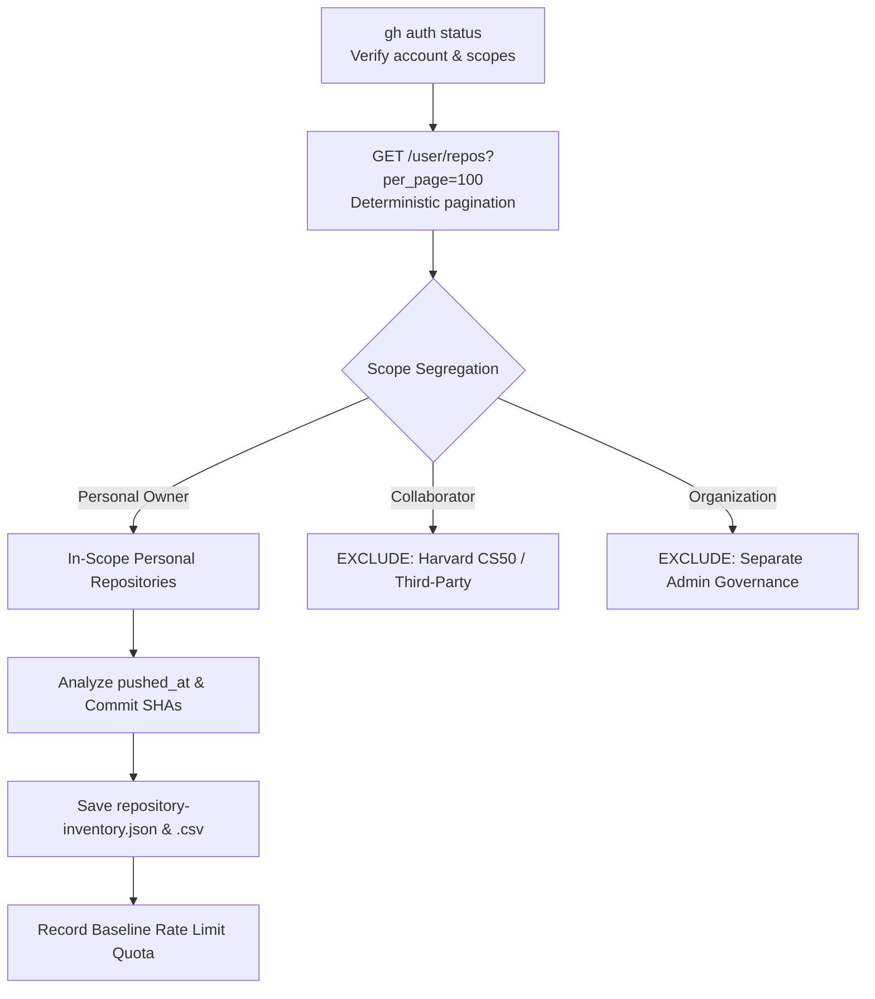
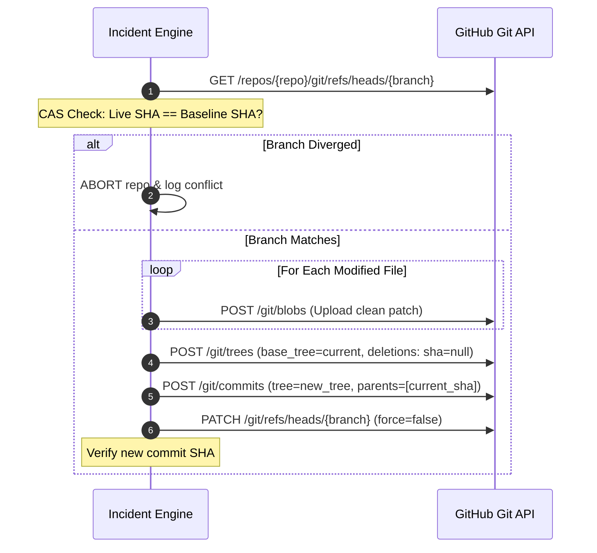

# GitHub Incident Response Playbook: Coordinated Compromise Remediation & Hardening

**Playbook Version**: 1.0  
**Domain**: Software Supply Chain Security, Cloud Repository Incident Response  
**Target Environment**: GitHub REST/GraphQL APIs, GitHub CLI (`gh`), Git Database Architecture  

---

## A. Purpose & Activation Conditions

This skill provides an evidence-based operational methodology and supporting toolset for responding to suspected coordinated compromises across GitHub accounts.

### When to Activate This Skill:
- **Automated Push Surges**: Multiple repositories updated, pushed, or created within a clustered time window (e.g., dozens of repositories pushed within minutes).
- **Commit History Anomaly**: Commits appearing with suspicious author or committer dates, amended timestamps, or standardized commit messages across unrelated repositories.
- **Disguised Executable Payloads**: Text files or scripts masquerading as binary media assets (e.g. font files containing ASCII JavaScript).
- **Stealth IDE Auto-Run Backdoors**: Suspicious `.vscode/tasks.json` configured with `"runOptions": {"runOn": "folderOpen"}` or `.vscode/settings.json` configuring `"task.allowAutomaticTasks": true`.
- **Package Lifecycle Injections**: `package.json` scripts (`dev`, `start`, `preinstall`, `build`) prepended with unexpected node commands (e.g., `node api.js &&`).
- **Bundler / Linter Config Tampering**: Unexpected trailing code or whitespace padding added to `postcss.config.*`, `next.config.*`, `vite.config.*`, or `eslint.config.*`.
- **Exposed Secrets & Environment Files**: Accidental tracking of `.env` files, leaked credentials, or unexplained deployment activities.

> [!IMPORTANT]
> **EVIDENCE REQUIREMENT**: A recent commit timestamp, a common filename (`api.js`, `fa-brands-400.ttf`), or a single heuristic match is **never** sufficient evidence to classify a repository as compromised. Incident response actions must be grounded in multi-factor cryptographic, structural, and behavioral correlation.

### Two-Stage Operating Architecture:
To prevent destructive mistakes, operational actions are strictly partitioned:
1. **Stage 1: Investigation Mode (Strictly Read-Only)**: Enforces read-only inspection, census enumeration, evidence preservation, signature matching, and pre-generation of local replacement patches. **No remote changes are permitted.**
2. **Stage 2: Remediation Mode (Authorized Atomic Writes)**: Requires explicit owner authorization. Executes surgical, atomic Git Database API operations protected by Compare-and-Swap (CAS) parent verification and immediate post-commit tree validation.

---

## B. Mandatory Safety Rules

Every investigator or automated coding agent executing this skill must adhere to these non-negotiable rules:

1. **Strictly Read-Only by Default**: Begin all investigations in Investigation Mode. Never modify, create, delete, or push remote refs, branches, or files without explicit authorization.
2. **Never Execute Untrusted Repository Code**:
   - Do NOT run suspicious scripts, fake font files, `api.js`, package scripts, IDE tasks, or build configurations.
   - Do NOT run `npm install`, `yarn`, `pip install`, `cargo build`, or package lifecycle hooks on untrusted code.
3. **No Blind Git Network History Operations**:
   - Do NOT run `git fetch`, `git pull`, `git clone`, `git remote update`, merge, rebase, cherry-pick, or force-push during reconnaissance or cleanup.
   - Performing local Git clones of 90+ compromised repositories exposes the workstation to automated IDE tasks (`folderOpen`) and risks local environment compromise. Use GitHub REST/GraphQL API tree queries instead.
4. **Credential Protection & Zero Exposure**:
   - Never print, log, or export GitHub tokens, passwords, private keys, or `.env` values.
   - Never paste credentials into command lines or public investigation logs.
5. **No Filename-Only Deletions**: Never delete a file based solely on its filename, extension, or directory path. Always verify magic bytes, SHA-256 hashes, or structural signatures.
6. **Preserve Legitimate Code**: Surgical cleanup must preserve all legitimate developer code, application dependencies, custom scripts, and workspace configurations.
7. **Strict Scope Governance**: Exclude collaborator-owned repositories, organization-owned repositories, and unrelated third-party projects from automated remediation unless explicit written authorization is granted by upstream owners.
8. **Verify Every Write**: Never assume an HTTP 200/201 response proves a commit succeeded as intended. Always perform an independent read-only tree verification.
9. **Never Claim Comprehensive Cleanliness Prematurely**: Default-branch tree remediation cleans the active head; it does not erase historical commits, clean unmerged branches, or sanitize local developer machines. Always use the phrasing: *"verified clean within the stated scope"*.

---

## C. Phase 1 — Reconnaissance & Inventory

The objective of Phase 1 is to establish a complete account census, segregate administrative scope, and identify anomalous update windows.

### Operational Steps:
1. **Identity & Scope Verification**:
   - Execute `gh auth status` to confirm active account and verified scopes (`repo`, `read:org`).
   - Query `/user` to obtain authenticated user metadata.
2. **Deterministic Repository Enumeration**:
   - Query `/user/repos?per_page=100&affiliation=owner,organization_member,collaborator`.
   - Paginate until all records are retrieved (`len(results) < per_page`).
   - Record repository full name, URL, visibility (public/private), default branch, archived status, push timestamp, and branch-tip commit SHA.
3. **Scope Partitioning**:
   - Strictly segregate personal repositories (`repo['owner']['login'] == user_login`) from collaborator-accessible and organization repositories.
4. **Push Surge & Timestamp Anomaly Analysis**:
   - Correlate `pushed_at`, commit `author.date`, and `committer.date`.
   - Threat actors frequently amend Git commits to set author timestamps in the past (e.g. Oct 13), while GitHub's `pushed_at` reveals the true burst push window (e.g. Oct 14 14:19–14:25 UTC).
5. **API Quota Baseline Audit**:
   - Query `GET /rate_limit`. Record starting core quota (e.g. 5,000) and reset epoch.
6. **Artifact Generation**:
   - Save `repository-inventory.json`, `repository-inventory.csv`, and `branch-and-tag-inventory.csv` in a timestamped reconnaissance folder (e.g., `recon-YYYYMMDD_HHMMSS/`).

---

## D. Phase 2 — Malware Confirmation & Full-Scope Scanning

Phase 2 moves from account-level metadata to deep static analysis of representative repositories to establish cryptographic and structural signatures.

### Historical Malware Signatures (Campaign `CAMPAIGN-202610-GH-DEVDRIVE`):
The following signatures represent verified threat indicators established during the incident:

1. **`SIG-202610-FONT-PAYLOAD-TTF` (Disguised JavaScript Loader)**:
   - **Target File**: `fa-brands-400.ttf` (placed in `public/fonts/` or nested inside deep app paths).
   - **Cryptographic Signature**: SHA-256 `b1b7e39cd73f3d26ca4d9a7d335730f1d5c23db022b17c76248eb2475a985cea`, size `27,525 bytes`.
   - **Structural Signature**: Magic bytes `28 66 75 6e` (ASCII `(fun`). Not a binary font (which begins with `00 01 00 00` or `OTTO`).
   - **Companion Suite**: Fake `README.md` (`462725bd6964a784d09320e8a719d36e2f1648a0494be108b991515bb2b453a2`, 811 bytes, claiming *"Blockchain Explorer"*) and 15 dummy font files.
   - **Status**: **CONFIRMED MALICIOUS**. Deletion required.
2. **`SIG-202610-VSCODE-AUTORUN` (Silent IDE Auto-Run Backdoor)**:
   - **Target File**: `.vscode/tasks.json`.
   - **Structural Signature**: Task labeled `"eslint-check"` with `"runOptions": {"runOn": "folderOpen"}` and `"presentation": {"reveal": "never"}` executing `node .../fa-brands-400.ttf`.
   - **Status**: **CONFIRMED MALICIOUS**. Task removal or file deletion required.
3. **`SIG-202610-VSCODE-AUTO-PERMIT` (Auto-Task Permission Bypass)**:
   - **Target File**: `.vscode/settings.json`.
   - **Structural Signature**: `"task.allowAutomaticTasks": true` and `"debug.openDebug": "neverOpen"`.
   - **Status**: **CONFIRMED MALICIOUS IN CONTEXT**. Key pruning required.
4. **`SIG-202610-ROOT-DROPPER` (Root Obfuscated Dropper)**:
   - **Target File**: Root `api.js`.
   - **Structural Signature**: Mock API exports (`status: 200`, `mock-token`), followed by 200+ space characters on Line 16, hiding `var z = '-10846'` and `(function boot(...)(global, require))`.
   - **Injected Fragment Hash**: SHA-256 `bbe9336ab30cbcd5063fd4e5676d7efd91a764ee331ee34372ee99f031efaeae`.
   - **Status**: **CONFIRMED MALICIOUS**. Deletion required.
5. **`SIG-202610-PACKAGE-SCRIPT-INJECTION` (Lifecycle Script Trigger)**:
   - **Target File**: `package.json`.
   - **Structural Signature**: Scripts prepended with `node api.js && `.
   - **Status**: **CONFIRMED MALICIOUS**. Surgical regex removal required (`re.sub(r'node\s+api\.js\s*&&\s*', '', script)`).
6. **`SIG-202610-CONFIG-TRAILING-INJECTION` (Build Config Hijack)**:
   - **Target Files**: `postcss.config.mjs`, `eslint.config.js`.
   - **Structural Signature**: Export line padded with 200+ spaces followed by 28KB obfuscated payload.
   - **Injected Fragment Hash**: SHA-256 `a299375a6d84b36de87d574acb8e66bf73d2e6f8420a52686c1a8f969b4c87b4`.
   - **Status**: **CONFIRMED MALICIOUS**. Truncate trailing payload and restore clean config.

### Full Scan Execution:
- Scan 100% of in-scope repository trees using `/git/trees/{branch_tip}?recursive=1`.
- Match every file against verified signatures and negative false-positive rules.
- Classify repositories into: `CONFIRMED MALICIOUS`, `CLEAN`, `SUSPICIOUS`, or `INCOMPLETE`.
- Save findings to `repository-findings.csv`.

---

## E. Phase 3 — Remediation Planning & Manifest Generation

Before any remote modification is performed, a complete, machine-readable manifest must be pre-generated.

### Manifest Specifications (`remediation-manifest.json`):
Each manifest action must record:
- `repository`: Full repository name (`owner/repo`).
- `default_branch`: Target branch name.
- `action`: `DELETE` or `MODIFY`.
- `path`: Target file path in repository tree.
- `original_sha`: SHA-256 hash of compromised file.
- `clean_patch_file`: Relative path to pre-generated clean replacement file in `patches/` (for `MODIFY`).
- `signature_id`: Corresponding detection signature.
- `confidence`: `HIGH` or `CONFIRMED`.

### Reconciling Manifest Arithmetic:
Always reconcile total action counts before moving forward:
$$\text{Total Actions} = \text{File Deletions} + \text{Surgical File Modifications}$$
Verify that every `MODIFY` action points to an existing patch file on disk, and verify that 0% of patch files contain remnant malware strings.

### Tracked Environment File Discovery:
Audit repository trees for tracked `.env` files.
- Never log, print, or export secret values.
- Record metadata in `tracked-environment-files.csv` (repository, path, size, risk rating).
- Live `.env` files must be flagged for provider-level rotation and subsequent untracking.

---

## F. Phase 4 — Authorized Bulk Cleanup (Atomic Git Operations)

Executing bulk cleanup via local Git clones is slow, dangerous, and error-prone. Instead, execute atomic commits directly via the **GitHub Git Database REST API**.

### Safety & Concurrency Protections:
1. **Compare-and-Swap (CAS)**: Read the live branch tip immediately before modifying. If `live_sha != expected_parent_sha`, halt execution on that repository immediately.
2. **Blob Generation**: Create clean Git blobs via `POST /repos/{repo}/git/blobs` (`encoding: "utf-8"`).
3. **Atomic Tree Mutation**: Submit a single tree object via `POST /repos/{repo}/git/trees` referencing `base_tree`:
   - Deleted paths: `{"path": p, "mode": "100644", "type": "blob", "sha": None}`.
   - Modified paths: `{"path": p, "mode": "100644", "type": "blob", "sha": new_blob_sha}`.
4. **Single Remediation Commit**: Create one atomic commit per repository via `POST /repos/{repo}/git/commits` with standard message (`security: remediate compromised assets and configurations`).
5. **Safe Reference Update**: Execute `PATCH /repos/{repo}/git/refs/heads/{branch}` with `force: false`.
6. **Ambiguous Response Handling**: If an API call times out or returns an unexpected status, do NOT blindly retry. Query `GET /repos/{repo}/git/refs/heads/{branch}` to inspect whether the commit was already applied.

---

## G. Phase 5 — Post-Commit Verification & Hardening

Verification must be conducted independently via read-only API calls immediately following each commit.

### Verification Criteria:
1. **Parent Linkage**: The new branch tip commit must have the pre-modification commit as its sole parent.
2. **Tree Cleanliness**: Query `/git/trees/{new_commit_sha}?recursive=1`. Confirm 100% absence of all deleted malicious paths.
3. **Patch Verification**: Read modified files from the tree to verify that clean code is active and undamaged.
4. **Source Code Integrity**: Confirm that legitimate application code and directory structures outside the malicious paths remain intact.

### Security Hardening Enforcement:
Following malware cleanup, apply account-wide repository hardening:
1. **Standardized `.gitignore`**: Append rules ignoring `.env`, `.env.*`, and `.vscode/` while preserving allowed templates (`!.env.example`, `!.env.sample`, `!.env.template`).
2. **Complete `.vscode/` Purge**: Delete the `.vscode/` directory from Git tracking across all repositories.
3. Apply changes via atomic CAS-protected commits (`security: harden gitignore and remove vscode workspace`).

---

## H. Phase 6 — Credential & Host Response

Default-branch remediation resolves active payloads on GitHub. Incident closure requires thorough host and identity remediation:

1. **Token & Key Revocation**:
   - Revoke all existing GitHub Personal Access Tokens (classic and fine-grained).
   - Generate a new fine-grained token with minimal permissions.
   - Review `/user/keys` and delete any unrecognized SSH keys.
   - Review OAuth applications and deploy keys.
2. **Rotating Exposed Secrets**:
   - For all repositories flagged in `tracked-environment-files.csv`, immediately rotate database passwords, API keys, and JWT secrets at their respective providers.
   - Untrack files from Git: `git rm --cached .env && git commit -m "security: untrack sensitive .env" && git push`.
3. **Local Developer Workstation Audit**:
   - Set global VS Code user configuration: `"task.allowAutomaticTasks": "off"`.
   - Inspect active processes for unauthorized Node or shell processes.
   - Audit startup persistence locations (Task Scheduler, LaunchAgents, shell profiles).
   - Synchronize local Git checkouts (`git checkout <branch> && git pull origin <branch>`).

---

## I. Checkpoints, API Quotas & Recovery

Automated operations across dozens of repositories must be resilient to rate limits and network drops.

### Checkpoint Guidelines (`checkpoint-template.json`):
- Persist state to `checkpoint.json` after every single repository transaction.
- Track completed repositories, pending repositories, baseline SHAs, and new commit SHAs.
- Query `GET /rate_limit` before each batch.
- **Quota Safety Floor**: Maintain a minimum safety buffer of 1,000 API requests. If remaining quota falls below 1,000, checkpoint state, report remaining work, and pause safely until the reset epoch.

---

## J. Reporting & Completion Criteria

Every incident response engagement must conclude with a comprehensive final report using `templates/incident-report-template.md`.

### Required Report Elements:
1. Scope definition and explicit exclusions (collaborator/org repos).
2. Complete repository census (total, confirmed infected, clean, skipped, failed).
3. Verified malware signatures, IoCs, and false-positive criteria.
4. Execution ledger with before/after commit SHAs, commit URLs, and action counts.
5. Post-commit verification results (parent linkage, tree cleanliness).
6. Tracked environment file exposure catalog and credential rotation status.
7. Host and workstation sanitation guidance.
8. Standard completion phrase: *"All in-scope repositories have been remediated and verified clean within the stated scope."*
