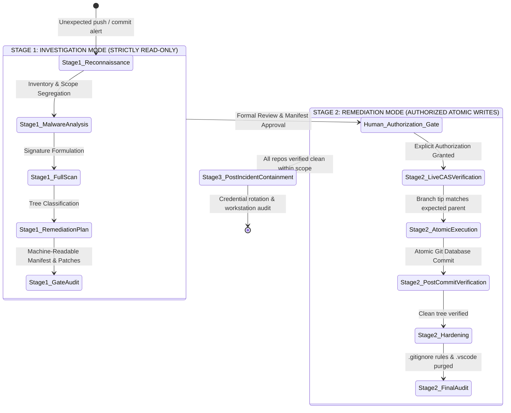
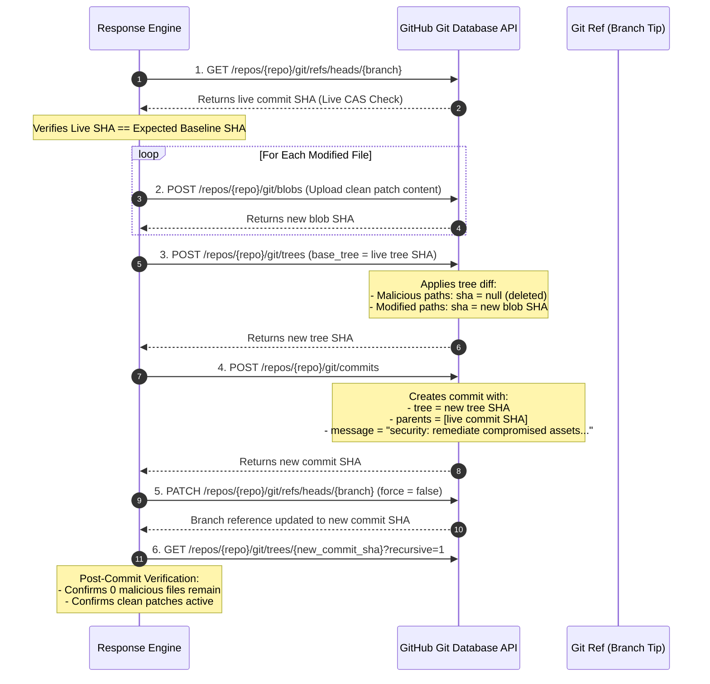

# GitHub Security Incident Response Workflow

**Document Version**: 1.0  
**Target Scope**: End-to-End Operational Lifecycle for Coordinated GitHub Compromises  
**Guiding Architecture**: Two-Stage Operating Model (Investigation vs. Remediation)

---

## 1. Architectural Philosophy: The Two-Stage Operating Model

To prevent catastrophic accidental damage, data loss, or premature remote mutations, the incident response lifecycle is strictly partitioned into two operational modes:

### Stage 1: Investigation Mode (Strictly Read-Only)
- **Permissions**: Pure GET requests via GitHub REST and GraphQL APIs. Zero Git network operations (`git fetch`, `pull`, `clone`, `push`).
- **Goal**: Full census, scope segregation, threat intelligence analysis, signature formulation, 100% repository scanning, and pre-generation of local patches and manifests.
- **Output**: Machine-readable remediation manifest (`remediation-manifest.json`), patch files (`patches/`), and comprehensive findings.
- **Constraint**: **Zero remote changes permitted.** No branches moved, no files deleted, no settings altered.

### Stage 2: Remediation Mode (Authorized Atomic Writes)
- **Prerequisite**: Explicit, written authorization from the repository owner after reviewing Stage 1 deliverables.
- **Permissions**: Atomic Git object manipulation via Git Database REST API (`POST /git/blobs`, `POST /git/trees`, `POST /git/commits`, `PATCH /git/refs/heads/*`).
- **Safety Controls**:
  - Compare-and-Swap (CAS) parent verification on every repository before write.
  - Rate-limit floor monitoring with automated checkpointing.
  - Immediate post-commit read-only tree verification.

---

## 2. Step-by-Step Operational Workflow

### Step 1: Authentication & Scope Partitioning
1. Run `gh auth status` to confirm identity and active token scopes (`repo`, `read:org`). Do not log or print token secrets.
2. Query `/user/repos?per_page=100&affiliation=owner,organization_member,collaborator`.
3. Rigorously partition repositories into three governance tiers:
   - **Personally Owned Repositories**: In-scope for remediation.
   - **Collaborator / Forked Repositories**: Read-only inspection only. Excluded from automated bulk remediation unless explicitly authorized by upstream owners.
   - **Organization Repositories**: Segregated under organizational policy.
4. Save initial inventory to `repository-inventory.json` and `repository-inventory.csv`.

### Step 2: Push Surge & Activity Timeline Analysis
1. Extract `pushed_at`, commit `author.date`, and `committer.date` across all in-scope repositories.
2. Detect clustering anomalies: Look for multiple repositories updated within minutes of each other (e.g., 90+ repositories pushed across a 6-minute window).
3. Check for commit history tampering: Compare author dates against committer dates. Threat actors frequently amend existing commits with fake author timestamps (e.g. October 13) while the actual push occurred on October 14.

### Step 3: Deep Sample Inspection & Signature Validation
1. Select 5–10 representative repositories exhibiting the compromise pattern.
2. Query the complete Git tree using `/repos/{owner}/{repo}/git/trees/{branch_tip}?recursive=1`.
3. Locate suspicious files:
   - Disguised assets (`fa-brands-400.ttf`, fake fonts).
   - IDE tasks (`.vscode/tasks.json` with `runOn: folderOpen`).
   - Root droppers (`api.js`).
   - Injected configs (`postcss.config.mjs`, `package.json`).
4. Read file blobs inertly via GitHub API (base64 decoded). **Never execute retrieved files.**
5. Verify magic bytes, cryptographic hashes, and exact byte counts.
6. Correlate findings with negative rules in `false-positives.md` to establish reliable signatures.

### Step 4: Full Scope Scanning & Classification
1. Execute automated read-only tree scanning across all in-scope repositories.
2. Classify each repository into:
   - **`CONFIRMED MALICIOUS`**: Matches one or more verified compromise signatures.
   - **`CLEAN`**: 100% scan completed with zero indicators found.
   - **`SUSPICIOUS`**: Unrecognized anomalous files requiring manual expert review.
   - **`INCOMPLETE`**: API timeout, permissions failure, or rate limit threshold hit.
3. Save scan findings to `repository-findings.csv`.

### Step 5: Remediation Manifest & Patch Preparation
1. For every confirmed malicious file, generate a planned action:
   - `DELETE`: Disguised font suites, root `api.js` droppers, malicious `.vscode/tasks.json`.
   - `MODIFY`: Clean surgical replacement of `package.json`, `.vscode/settings.json`, and `postcss.config.mjs`.
2. Generate physical clean replacement files in a local `patches/` directory.
3. Validate all replacement patches (AST syntax check, ensure 0% residual malicious code, 100% preservation of legitimate developer configurations).
4. Compile `remediation-manifest.json` cataloging every action with original SHA-256 and target replacement path.
5. Audit and inventory pre-existing tracked environment files (`tracked-environment-files.csv`) without logging secret contents.

---

## 3. Atomic Git Database Remediation Execution

Executing bulk remediation by cloning 90+ repositories locally is slow, dangerous (risks local execution of auto-run hooks), and prone to merge conflicts. Instead, all changes are applied atomically via the **GitHub Git Database REST API**:

### Safety & Concurrency Protections:
1. **Compare-and-Swap (CAS)**: If any remote commit was pushed between the scan and remediation execution, the live SHA will not match the expected baseline SHA. The engine immediately aborts and flags the repository.
2. **Atomic Commits**: All deletions and modifications for a given repository occur within a single commit. A repository is never left in a partially remediated state.
3. **Non-Forced Updates**: The `force: false` parameter guarantees that if a race condition occurs, GitHub's ref update rejects the write.
4. **Resumable Checkpoints**: State is persisted to `cleanup-checkpoint.json` after every single repository update. If the network drops or quota is depleted, execution resumes exactly where it stopped.

---

## 4. Post-Commit Verification Standards

A remediation commit is never accepted as successful based solely on an HTTP 200 response from GitHub:
1. **Parent Linkage Audit**: Verify that the commit's parent SHA equals the pre-modification branch tip.
2. **Tree Absence Audit**: Traverse the resulting tree to confirm that zero malicious paths exist.
3. **Patch Verification**: Read modified files from the new tree to verify that clean content was applied without truncation or character encoding corruption.
4. **Audit Ledger Logging**: Record before/after commit SHAs, commit URLs, and verification outcomes in `remediation-execution-log.csv` and `post-remediation-verification.csv`.
