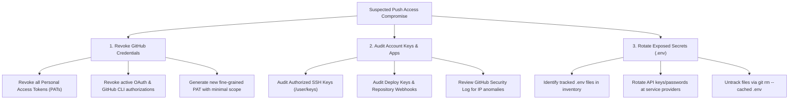

# Post-Remediation Recovery, Credential Rotation & Containment Guide

**Document Version**: 1.0  
**Target Scope**: Post-Incident Credential Lifecycle, Host Sanitation & Scope Limitations  
**Guiding Principle**: Defense in Depth & Eradication Beyond the Default Branch

---

## 1. Scope Limitations of Branch-Level Remediation

Remediating the default branch of a GitHub repository is an essential first step, but it **does not** constitute full incident closure:

> [!IMPORTANT]
> **SCOPE BOUNDARY**: Modifying the current default-branch tree removes active persistence payloads from new clones. However, it does **not**:
> 1. Erase historical copies of malware or leaked credentials embedded in prior Git commits.
> 2. Remediate unmerged feature branches, secondary branches, or Git release tags.
> 3. Revoke leaked credentials, compromised API keys, or stolen session tokens.
> 4. Cleanse developer workstations or CI/CD runners where compromised code was previously checked out or executed.

---

## 2. Mandatory Credential Revocation & Rotation Procedures

When a GitHub account suffers an automated push campaign, assume that the credentials used to authenticate the pushes are compromised.



### 2.1 GitHub Account Credentials
1. **Personal Access Tokens (PATs)**:
   - Navigate to `https://github.com/settings/tokens`.
   - Revoke all classic tokens and fine-grained PATs immediately.
   - Re-authenticate `gh` CLI with a new token restricted to strictly necessary scopes and an expiration date.
2. **Authorized SSH Keys**:
   - Query `GET /user/keys` or visit `https://github.com/settings/keys`.
   - Inspect every public key listed. Immediately remove any key that does not correspond to a known, currently secured workstation.
3. **OAuth Apps & Integrations**:
   - Review `https://github.com/settings/applications`.
   - Revoke any third-party application or service that is unrecognized or no longer required.
4. **Account Security Audit Log**:
   - Inspect `https://github.com/settings/security-log`.
   - Filter for `repo.create`, `repo.push`, and `public_key.create` events during the compromise window to verify the source IP addresses and authentication mechanisms used.

### 2.2 Rotating Secrets Found in Tracked Environment Files
During the documented incident, two repositories were discovered with live `.env` files tracked in Git:
- `AforArdi/passkeeper` (`.env`, 90 bytes) — **CRITICAL RISK**
- `AforArdi/typescript-1` (`.env`, 65 bytes) — **CRITICAL RISK**
- `AforArdi/fb-pic-py` (`.env.example`, 301 bytes) — Low Risk (Safe Public Template)

#### Handling Pre-Existing Tracked `.env` Files:
Adding `.env` to `.gitignore` does **not** stop Git from tracking files that were already committed.
1. **Do not silently delete the files from Git without rotating secrets first**: The credentials have already been exposed to anyone with read access to the repository or its commit history.
2. **Rotate the credentials at the service provider**:
   - Database passwords (e.g., PostgreSQL, MongoDB, MySQL).
   - API keys (e.g., OpenAI, Stripe, AWS, SendGrid).
   - JWT secrets, encryption keys, and session cookies.
3. **Untrack the file without deleting it from local developer disks**:
   ```bash
   git rm --cached .env
   git commit -m "security: untrack sensitive environment configuration"
   git push origin <default-branch>
   ```

---

## 3. Developer Workstation Sanitation & Host Response

Because the malware campaign specifically engineered `.vscode/tasks.json` with `runOptions: { runOn: folderOpen }` and planted `.vscode/settings.json` with `task.allowAutomaticTasks: true`, **any developer who opened an infected repository in VS Code may have triggered the payload locally**.

### Step 1: Prevent Automatic Task Execution Globally
Open VS Code User Settings (`%APPDATA%\Code\User\settings.json` on Windows or `~/.config/Code/User/settings.json` on Linux/macOS) and enforce:
```json
{
  "task.allowAutomaticTasks": "off",
  "security.workspace.trust.enabled": true
}
```

### Step 2: Inspect Active Processes & Network Connections
On Windows (PowerShell):
```powershell
# Check for suspicious Node processes running from unusual paths
Get-CimInstance Win32_Process -Filter "Name = 'node.exe'" | Select-Object ProcessId, CommandLine

# Check active outbound connections to external IPs
Get-NetTCPConnection -State Established | Where-Object { $_.RemoteAddress -notlike "127.*" -and $_.RemoteAddress -notlike "192.168.*" -and $_.RemoteAddress -notlike "10.*" }
```

### Step 3: Inspect Persistence Mechanisms
Check common developer persistence locations:
- **Windows**:
  - `Get-CimInstance Win32_StartupCommand`
  - Task Scheduler (`Get-ScheduledTask | Where-Object { $_.State -ne 'Disabled' }`)
  - PowerShell profiles (`$PROFILE`)
- **macOS / Linux**:
  - `~/Library/LaunchAgents` and `/Library/LaunchDaemons`
  - Cron tabs (`crontab -l`)
  - Shell startup profiles (`~/.bashrc`, `~/.zshrc`, `~/.profile`)

---

## 4. Local Git Clone Synchronization

Developers with existing local clones of the remediated repositories must update their local references to ensure they do not accidentally re-push malicious commits:

```bash
# In each local clone:
git checkout <default-branch>
git fetch origin
git reset --hard origin/<default-branch>
```

---

## 5. Historical Git History Rewriting (Optional Phase)

The default-branch cleanup leaves historical malicious commits in Git reflogs and history. If corporate policy or data sensitivity requires purging all traces of the payload from repository history:

1. **Coordinate with Team**: History rewriting changes all commit SHAs and requires everyone to re-clone.
2. **Use `git-filter-repo`** (recommended over legacy `git filter-branch` or BFG):
   ```bash
   # Install git-filter-repo
   pip install git-filter-repo

   # Strip malicious paths from all branches and tags
   git filter-repo --invert-paths --path public/fonts/fa-brands-400.ttf --path api.js --path-glob '.vscode/*'
   ```
3. **Force-Push with Lease**:
   ```bash
   git push origin --all --force-with-lease
   git push origin --tags --force-with-lease
   ```

---

## 6. Incident Closure Standard

When reporting incident status to stakeholders, use precise, defensible language:
- **Correct Formulation**: *"All 95 in-scope personal repositories have been evaluated; 92 confirmed-infected repositories have had active malware persistence payloads removed from their current default branches and verified clean within the stated scope."*
- **Prohibited Formulation**: *"The GitHub account is 100% clean and fully secured."* (Such statements are misleading because historical commits, unmerged branches, and host-level persistence require independent verification).
