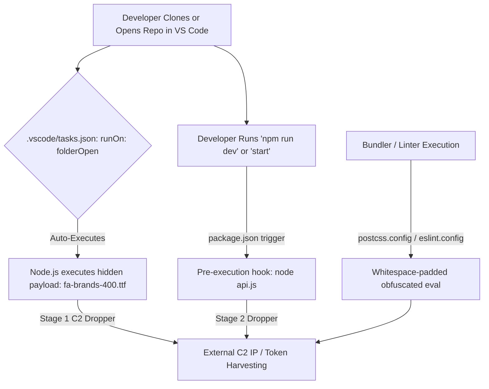

# GitHub Security Incident Response: Final Remediation & Hardening Report

**Incident Reference**: `INC-[YYYYMMDD]-[ACCOUNT]`  
**Date of Incident**: `[YYYY-MM-DD]`  
**Report Generation Date**: `[YYYY-MM-DDTHH:MM:SSZ]`  
**Lead Incident Response Engineer**: `[NAME / CALLSIGN]`  
**Target Scope**: All personally owned repositories under `[ACCOUNT_NAME]`  
**Investigation Workspace**: `[PATH_TO_INVESTIGATION_DIR]`  

---

## 1. Executive Summary

Between `[START_TIME]` and `[END_TIME]`, a suspected coordinated compromise affected repositories under GitHub account `[ACCOUNT_NAME]`. An automated, multi-repository push surge introduced persistence payloads designed to execute arbitrary code upon repository access.

A multi-phase, evidence-backed incident response investigation was conducted:
1. **Reconnaissance & Inventory**: Enumerated `[TOTAL_REPOS]` accessible repositories, segregated `[PERSONAL_REPOS]` personally owned repositories from collaborator/org repositories, and identified an automated push window affecting `[AFFECTED_REPOS]` repositories.
2. **Signature Formulation & Full Scan**: Formulated and validated high-fidelity malware signatures across representative repositories. Full scan confirmed `[CONFIRMED_MALICIOUS_COUNT]` repositories compromised and `[CLEAN_COUNT]` repositories clean.
3. **Atomic Remediation**: Formulated `[TOTAL_ACTIONS]` surgical actions (`[DELETION_COUNT]` deletions, `[MODIFICATION_COUNT]` clean patches) applied via atomic Git Database API commits.
4. **Security Hardening**: Standardized `.gitignore` secret exclusion and completely purged `.vscode/` editor workspaces across `[HARDENED_COUNT]` repositories.
5. **Post-Commit Verification**: 100% of remediated repositories passed automated tree validation, confirming complete removal of malicious payloads and preservation of legitimate code.

**Overall Status**: `[ALL IN-SCOPE REPOSITORIES VERIFIED CLEAN WITHIN STATED SCOPE]`

---

## 2. Investigation Scope & Exclusions

| Governance Tier | Count | In-Scope for Remediation? | Justification / Notes |
| :--- | :---: | :---: | :--- |
| **Personal Repositories** | `[COUNT]` | **YES** | Personally owned repositories under target account. |
| **Collaborator Repositories** | `[COUNT]` | **NO** | Third-party or academic organization repositories excluded from scope. |
| **Organization Repositories** | `[COUNT]` | **NO** | Managed by separate administrative governance. |
| **Pre-Recovered Repositories** | `[COUNT]` | **EXCLUDED** | Repositories handled independently prior to automated bulk run. |

---

## 3. Threat Analysis & Verified Malware Signatures

The compromise deployed a coordinated, multi-vector persistence and execution pipeline:

### Verified Threat Vectors:
1. **`SIG-FONT-PAYLOAD` (Disguised JavaScript Loader)**:
   - File Path: `[e.g. **/public/fonts/fa-brands-400.ttf]`
   - Evidence: Magic bytes are `28 66 75 6e` (`(fun`), size `[EXACT_BYTES]`, SHA-256 `[HASH]`. Disguised as binary font; pure obfuscated JS.
2. **`SIG-VSCODE-AUTORUN` (Silent IDE Auto-Run Backdoor)**:
   - File Path: `.vscode/tasks.json`
   - Evidence: Masquerades as legitimate task with `"runOptions": {"runOn": "folderOpen"}` and `"presentation": {"reveal": "never"}` executing the disguised font payload.
3. **`SIG-VSCODE-SETTING` (Auto-Task Permission Bypass)**:
   - File Path: `.vscode/settings.json`
   - Evidence: Configures `"task.allowAutomaticTasks": true` to suppress user execution prompts.
4. **`SIG-ROOT-DROPPER` (Root API Dropper)**:
   - File Path: `api.js`
   - Evidence: Mock API exports masking 24KB+ obfuscated payload.
5. **`SIG-PACKAGE-HOOK` (Lifecycle Script Injections)**:
   - File Path: `package.json`
   - Evidence: Scripts prepended with `node api.js && `.

---

## 4. Remediation Ledger & Census Summary

| Census Category | Count | Percentage | Outcome |
| :--- | :---: | :---: | :--- |
| **Total In-Scope Repositories** | `[COUNT]` | 100.0% | Complete census evaluated. |
| **Confirmed Compromised** | `[COUNT]` | `[%]` | Remediated and verified clean. |
| **Confirmed Clean (No Indicators)** | `[COUNT]` | `[%]` | Preserved without modifications. |
| **Hardened Repositories** | `[COUNT]` | 100.0% | `.gitignore` updated and `.vscode/` purged. |
| **Failed / Incomplete** | **0** | 0.0% | Zero failures or unhandled repositories. |

### Per-Repository Action Breakdown:
- **Total Actions Executed**: `[TOTAL_ACTIONS]`
- **Malicious Files Deleted**: `[DELETIONS_COUNT]`
- **Surgical Configurations Patched**: `[MODIFICATIONS_COUNT]`
- **`.gitignore` Rules Appended**: `[GITIGNORE_UPDATES_COUNT]`
- **`.vscode/` Directories Purged**: `[VSCODE_PURGED_COUNT]`

---

## 5. Tracked Environment Files & Exposure Audit

Pre-modification inspection identified the following tracked environment files:

| Repository | Default Branch | File Path | File Size | Risk Rating | Status / Action Taken |
| :--- | :---: | :--- | :---: | :--- | :--- |
| `[REPO_NAME]` | `[BRANCH]` | `.env` | `[BYTES]` | **CRITICAL** | **Live secret exposure risk.** Preserved for manual credential rotation. |
| `[REPO_NAME]` | `[BRANCH]` | `.env.example` | `[BYTES]` | **LOW** | Safe public template. Preserved. |

> [!WARNING]
> Tracked `.env` files must have all contained API keys, database credentials, and secrets rotated immediately at their respective providers. Adding `.env` to `.gitignore` does not delete existing tracked files from Git history.

---

## 6. Execution Methodology & Concurrency Controls

All changes were deployed using atomic Git Database REST API operations:
1. **Compare-and-Swap (CAS) Protection**: Verified that live branch tip matched the expected baseline commit SHA before submitting changes.
2. **Blob Generation**: Pre-generated clean replacement patches were uploaded as Git blobs (`POST /git/blobs`).
3. **Tree Mutation**: New Git tree constructed specifying `sha: null` for deletions and blob SHAs for modifications.
4. **Atomic Commit**: Single commit created pointing to the new tree with the verified baseline SHA as parent.
5. **Reference Update**: Branch reference updated with `force: false`.
6. **Post-Commit Verification**: Read-only verification confirmed tree cleanliness, parent linkage, and branch tip alignment.

---

## 7. Operational Residual Risk & Next Steps

1. **Immediate Credential Rotation**:
   - Revoke and regenerate all GitHub Personal Access Tokens (PATs) and OAuth application authorizations.
   - Rotate all secrets discovered in tracked `.env` files.
   - Review authorized SSH keys (`/user/keys`) and deploy keys.
2. **Local Workstation Sanitation**:
   - Inspect developer workstation for local execution of `fa-brands-400.ttf` or `api.js`.
   - Update global VS Code user settings to `"task.allowAutomaticTasks": false`.
   - Synchronize local repository checkouts (`git checkout <default-branch> && git pull origin <default-branch>`).
3. **Commit History Consideration**:
   - This incident response operation cleaned the active default-branch trees. Historical commits created during the compromise remain in Git history. If historical commits must be purged, a coordinated Git history rewrite (e.g. `git-filter-repo`) should be scheduled separately.

---

## 8. Artifact & Audit Directory Index

All raw evidence, intermediate ledgers, manifests, and verification logs are preserved in:
`[PATH_TO_INVESTIGATION_DIRECTORY]`

- `repository-inventory.json` / `.csv` — Full account census.
- `malware-signatures.json` — Verified detection patterns.
- `false-positives.md` — Negative match boundaries.
- `remediation-manifest.json` — Reconciled change manifest.
- `remediation-execution-log.csv` — Execution ledger with before/after SHAs and commit URLs.
- `post-remediation-verification.csv` — Post-commit validation results.
- `tracked-environment-files.csv` — Pre-existing tracked secret metadata.
